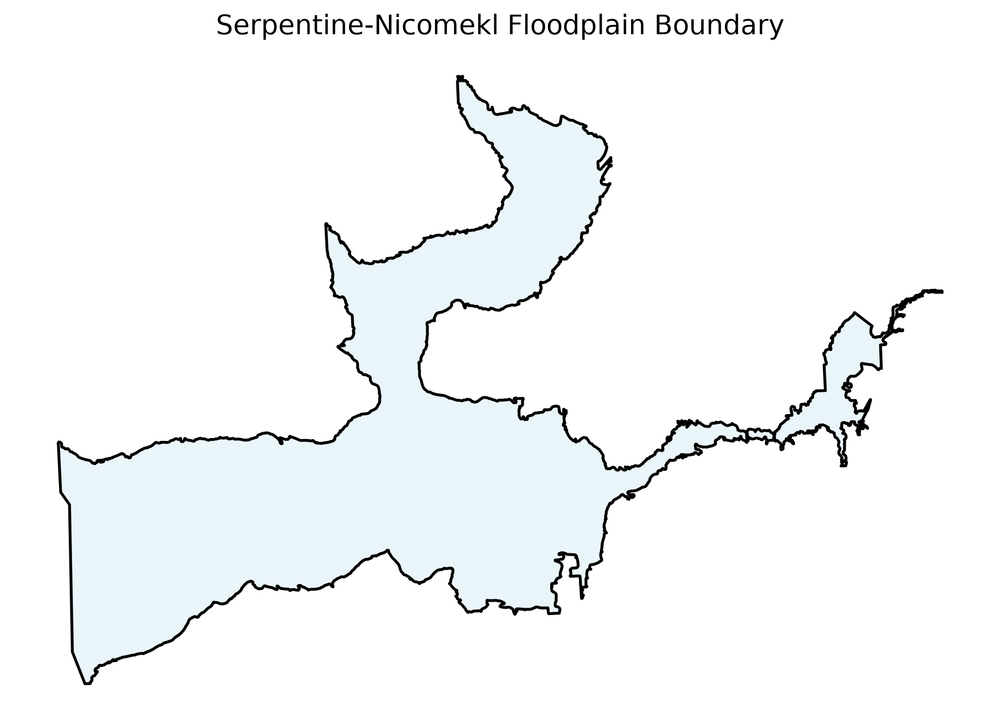
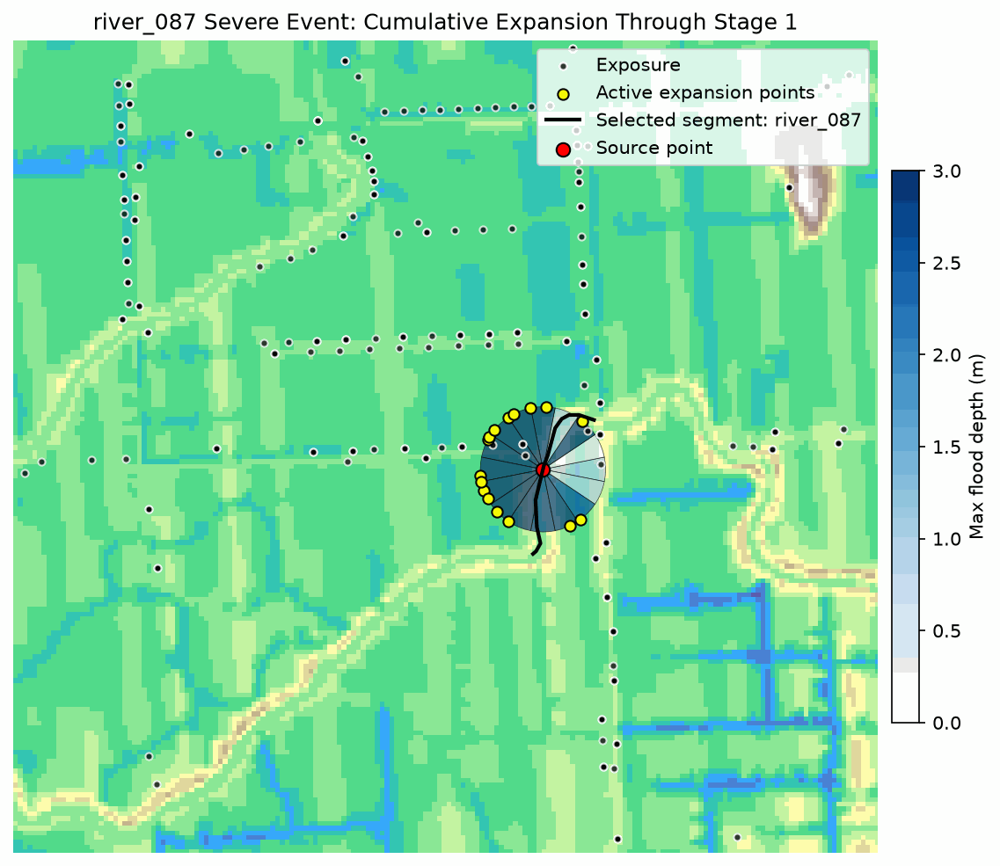

# Serpentine-Nicomekl Flood Catastrophe Framework

An event-based flood catastrophe modeling project by Isaac Wadhwani for the Serpentine-Nicomekl floodplain in British Columbia's Lower Mainland. The framework connects flood sources, terrain, protection infrastructure, property exposure, stochastic footprint growth, and HAZUS building damage curves.

**The output is a conditional flood-event gross building loss distribution.** Annual flood frequency and policy financial terms are outside this version's scope. The results should not be interpreted as annual average loss, annual return periods, or insured claims.

Read the [project report](reports/flood_catastrophe_model.pdf), or open the [walkthrough notebook](notebooks/01_flood_framework.ipynb).



## How it works

1. Score cleaned flood-source segments using low-elevation share and proximity to dikes or appurtenant structures.
2. Sample coastal, riverine, or interior-drainage flooding using assumed source weights of 20%, 40%, and 40%, then sample a source segment.
3. Sample event severity conditional on source type and physical segment score.
4. Grow a rule-based flood footprint using terrain, available water budget, depth caps, and staged spatial expansion. Coastal events also use a coastal storage-side mask.
5. Overlay the footprint with exposure, assign flood depths, interpolate HAZUS damage curves, and calculate building loss.
6. Repeat, preserve failed-event diagnostics, and summarize successful conditional event losses.



## Get started

Use Python 3.11 or 3.12. Open a terminal in the repository:

```bash
python -m venv .venv
```

Activate with `.venv\Scripts\activate` on Windows, or `source .venv/bin/activate` on macOS/Linux, then:

```bash
python -m pip install -r requirements.txt
python src/run_simulation.py --check-inputs
```

All eight prepared inputs are bundled. The lightweight `--check-files` option checks their presence and GeoJSON schemas without importing the geospatial stack. `--check-inputs` also loads vector layers and the DEM and imports the model; it does not score segments or simulate events.

### Explore saved results

```bash
python src/summarize_results.py
```

This regenerates summary statistics, a conditional loss histogram, and a conditional exceedance table from the archived 10,000-event CSV. It does not generate new flood events.

### Run new events

```bash
python src/run_simulation.py --n-sims 10 --seed 42 --output-dir outputs/example
```

For the historical batch layout:

```bash
python src/run_simulation.py --n-sims 10000 --batch-size 500 --seed 42 --output-dir outputs/full_run
```

The runner follows the final notebook's cleaned-segment branch: rescore the 729 cleaned source segments, buffer the floodplain expansion boundary by 5,000 metres, and seed batch `i` with `42 + i`. Changing the batch size changes the sequence of event seeds and therefore the simulated draws. Spatial simulations can be slow and use substantial memory; begin with a small event count.

Each batch writes event-level results. The runner combines these into a master CSV, saves configuration and scored segments, and summarizes successful events. Use `--save-affected` only when you also want the potentially large property-level batch outputs. All outputs go to `outputs/`; the archived `results/` folder is preserved. Failed events remain in the master CSV and are excluded from loss statistics, rather than treated as genuine zero-loss events.

## Archived results

The bundled master CSV matches the report's counts:

| Measure | Value |
| --- | ---: |
| Events attempted | 10,000 |
| Successful events | 9,996 |
| Failed events | 4 |
| Failure rate | 0.04% |
| Mean successful event gross loss | $1.389 million |
| Maximum successful event gross loss | $33.115 million |

Statistics above come from the archived master CSV. The original simulation has not been rerun during repository preparation. Small differences in geospatial libraries, ordering, and numerical behavior may affect future runs even with the same seed.

## Repository guide

| File or folder | Purpose |
| --- | --- |
| `src/run_simulation.py` | Portable entry point, input checks, scoring, batching, and export |
| `src/summarize_results.py` | Analyze archived or newly generated event results |
| `src/final_monte_carlo_simulation.py` | Original event orchestration and Monte Carlo engine |
| `src/assign_segment_score.py` | Physical source-segment scoring |
| `src/select_segment.py` | Source and segment sampling |
| `src/event_severity_distribution.py` | Source/score-dependent severity probabilities |
| `src/flood_footprint/core.py` | Shared staged footprint expansion mechanics |
| `src/flood_footprint/coastalV2.py` | Coastal footprint builder |
| `src/flood_footprint/riverine_interior_drainage.py` | Riverine and drainage footprint builders |
| `src/compute_property_damage.py` | Exposure overlay, depth conversion, damage interpolation |
| `src/compute_event_lossV3.py` | Property and event gross-loss aggregation |
| `data/processed/simulation/` | Prepared spatial inputs and HAZUS curves |
| `results/` | Original master event CSV and selected report figures |
| `reports/` | Unchanged September 20 report PDF |
| `notebooks/01_flood_framework.ipynb` | Guided input checks, saved-result review, and optional simulation |
| `scripts/extract_hazus_depth_damage_curves.R` | Historical curve extraction reference |
| `docs/` | Data provenance, packaging details, and verification |

The model's original imported modules are included unchanged. Earlier experiments and large affected-property archives remain in the local project.

## Scope and assumptions

This is an educational first-pass spatial simulation. Footprint growth is a heuristic rather than a calibrated hydraulic solver. Source weights, severity probabilities, water budgets, and footprint parameters are modeling assumptions. Internal QA establishes consistency; it does not establish accuracy against real flood depths or claims.

Exposure uses building-value proxies derived from assessment and zoning information. The model lacks policy deductibles, limits, contents, business interruption, and reinsurance. HAZUS curves have not been calibrated to local claims. Conditional event exceedance probabilities do not establish annual flood probabilities.

See [data provenance](docs/DATA.md) and [implementation notes](docs/IMPLEMENTATION.md). Source datasets remain subject to their original terms. No blanket software or data license is granted by this repository.
